# 📖 Manual de uso: Helpdesk Dashboard

Recorrido visual por la aplicación, en el orden real de uso: primero el panel de indicadores y después el ciclo de vida completo de un ticket. Las instrucciones de instalación, los comandos de Maven y la arquitectura están en el [README.md](README.md).

## Datos de demostración

La aplicación no necesita usuario ni contraseña. Al arrancar carga **300 tickets ficticios de los últimos 90 días**, generados siempre igual (semilla fija), para que el panel tenga datos desde el primer momento:

- La mayoría de los tickets antiguos están resueltos.
- Los de los últimos días siguen en cola o en curso.
- Unos pocos se han quedado atascados y aparecen fuera de SLA.

| Ruta | Pantalla |
|---|---|
| `/` | Panel de indicadores |
| `/tickets` | Listado de tickets |
| `/tickets/new` | Alta de ticket |
| `/tickets/{id}` | Detalle de un ticket |

## Panel de indicadores

**Panel del mes en curso** (`/`). Arriba, los cuatro indicadores clave:
- Tickets creados y resueltos en el mes.
- Pendientes: abiertos, en curso y cuántos ya están fuera de SLA.
- Tiempo de primera respuesta.
- Tiempo de resolución.

Los dos tiempos se muestran con media, mediana y porcentaje de SLA cumplido. Debajo están las gráficas, la tabla de tiempos por prioridad frente a su objetivo y los tickets pendientes más antiguos.

Las gráficas son interactivas. Al pasar el ratón por la evolución diaria, el tooltip muestra los tickets creados y resueltos ese día. Los datos de las gráficas llegan desde la API REST (`/api/metrics`).

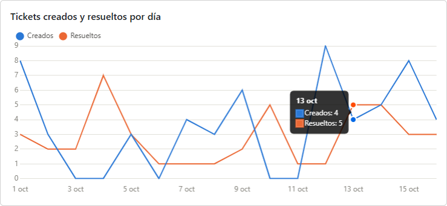

Con las flechas o el selector de mes se consulta cualquier mes anterior. Para un mes cerrado, los pendientes son los que quedaban sin resolver el último día de ese mes. El botón **Informe mensual (CSV)** descarga los indicadores del mes elegido en un fichero que se abre directamente en Excel.

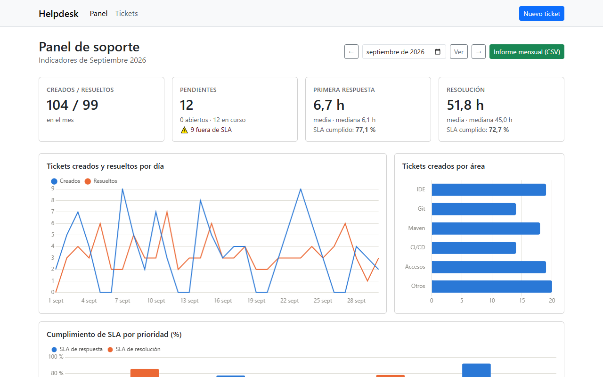

## Tickets

**Listado** (`/tickets`): todos los tickets del más reciente al más antiguo, con área, prioridad, estado, solicitante y técnico asignado. Se pagina de 20 en 20.

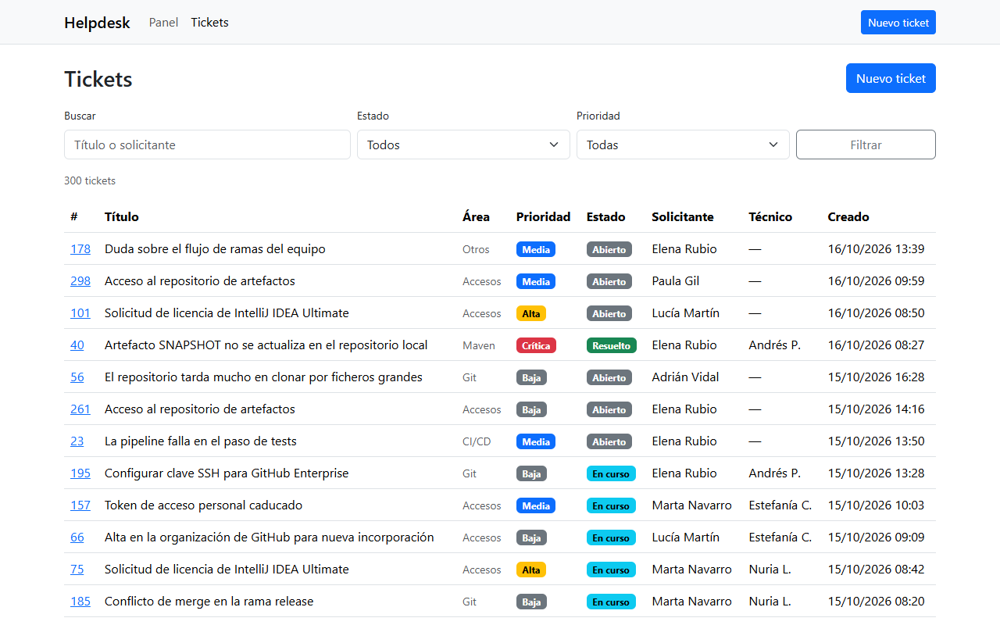

La búsqueda filtra por título o solicitante, y los desplegables filtran por **estado** y **prioridad**. En la captura: los tickets abiertos, es decir, los que esperan a que un técnico los atienda.

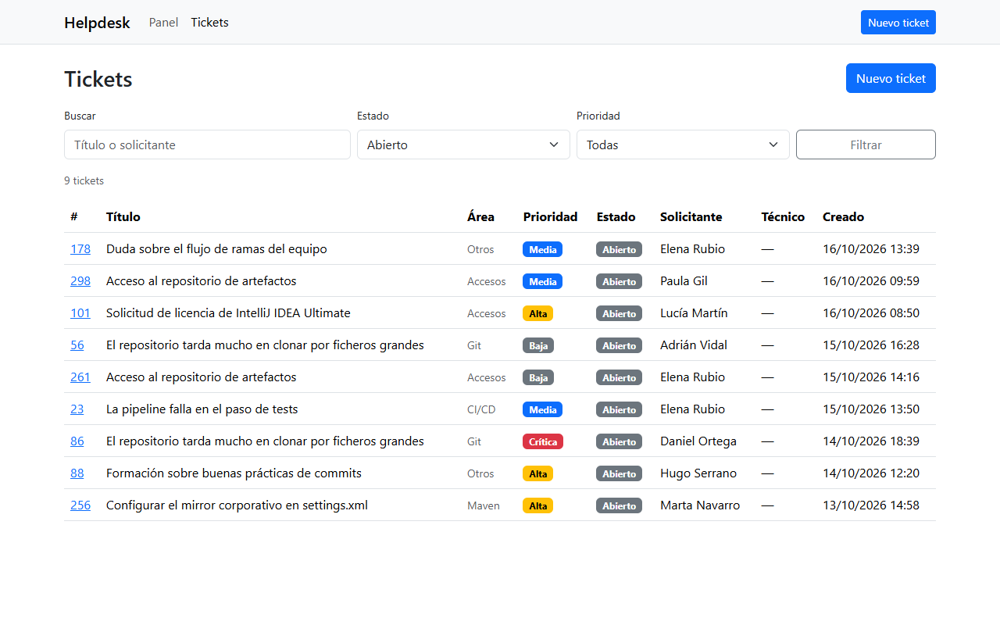

### Alta de un ticket

**Nuevo ticket** (`/tickets/new`). Si se envía el formulario incompleto, cada campo obligatorio muestra su error y no se guarda nada. El desplegable de prioridad indica el plazo de resolución de cada una.

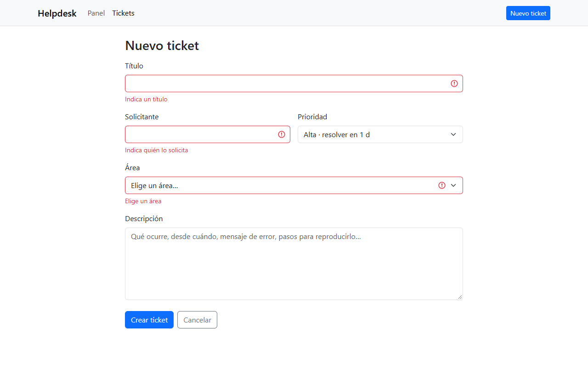

El mismo formulario relleno: título, solicitante, prioridad, área y una descripción con el mensaje de error y los pasos para reproducirlo.

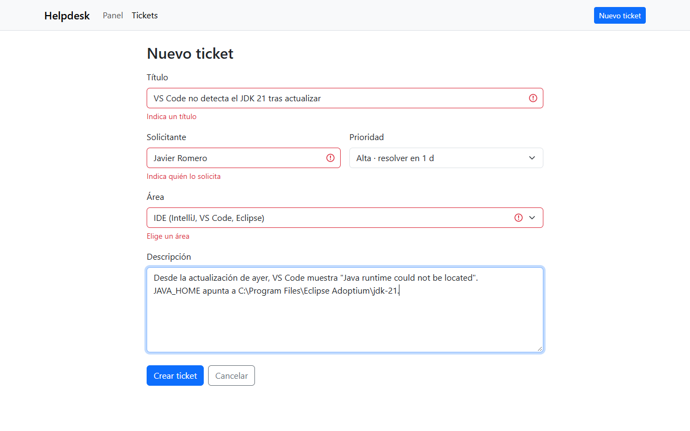

Al crearlo, la aplicación abre el **detalle del ticket** con un mensaje de confirmación. El ticket nace en estado **Abierto**, y a la derecha se ven los plazos de SLA que le corresponden por su prioridad (Alta: respuesta en 4 h y resolución en 24 h).

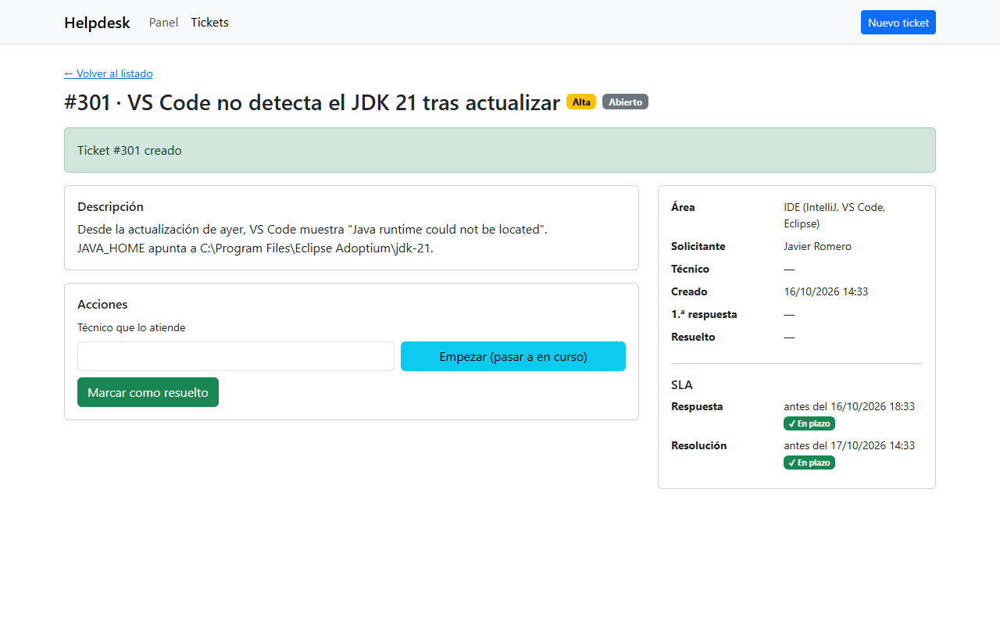

### Ciclo de vida

Un técnico atiende un ticket abierto de la cola: escribe su nombre y pulsa **Empezar**. El ticket pasa a **En curso** y ese momento cuenta como **primera respuesta**. En el ejemplo llegó 4 h 34 min después de crearse, dentro del objetivo de 8 h de la prioridad Media.

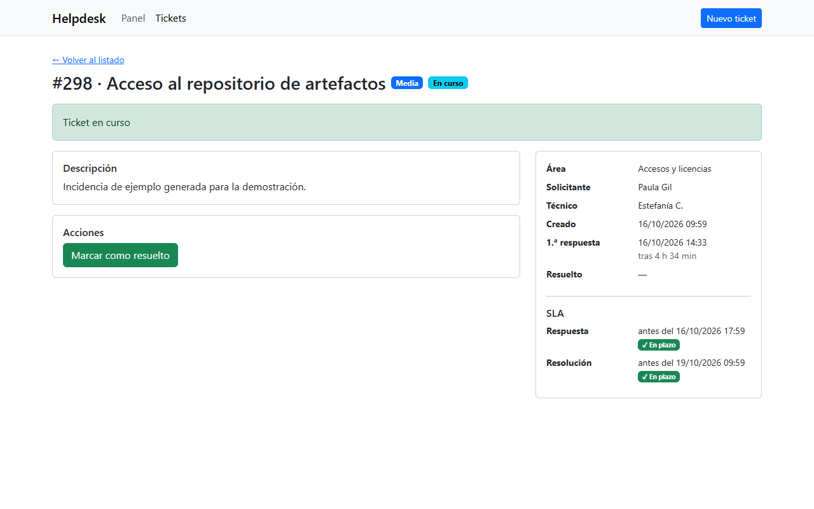

Al pulsar **Marcar como resuelto**, el ticket pasa a **Resuelto** y queda registrado el tiempo total de resolución. Si el problema vuelve a aparecer, **Reabrir** lo devuelve a *En curso* conservando la primera respuesta.

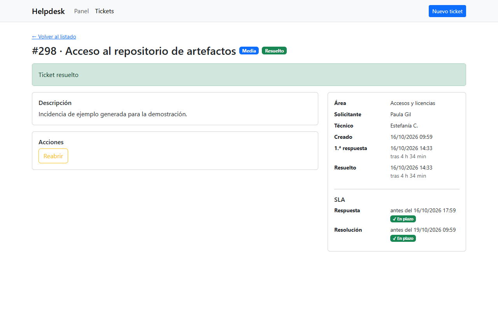

Así se ve un ticket **fuera de SLA**: el más antiguo de la tabla de pendientes del panel. Se respondió tarde y lleva semanas sin resolverse, así que los dos plazos aparecen en rojo con el aviso ⚠.

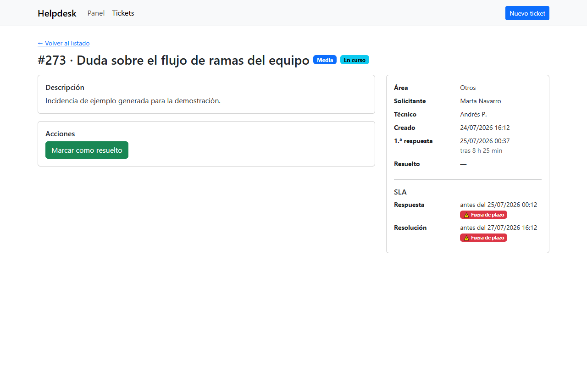

## Para soporte técnico e integraciones

Todo lo que se ve en pantalla está disponible en la **API REST**. Este es el ticket del ejemplo anterior (`GET /api/tickets/298`), con los tiempos calculados en minutos y los plazos de SLA:

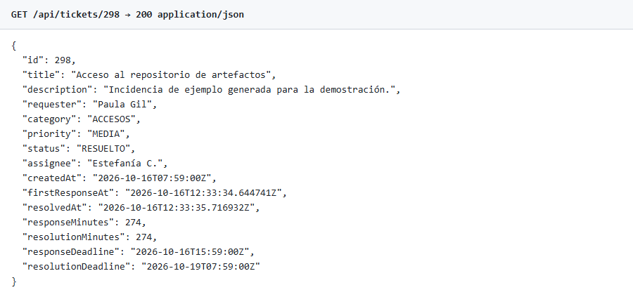

**Spring Boot Actuator** muestra el estado de la aplicación (`/actuator/health`) y los datos de la build (`/actuator/info`): artefacto, versión y fecha de compilación. Sirve para comprobar qué versión está desplegada sin entrar al servidor.

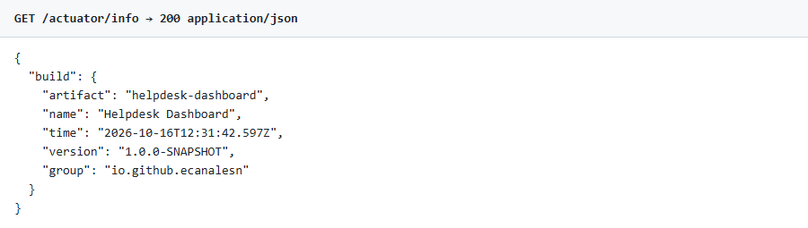

## Modo oscuro y móvil

La interfaz sigue el **tema del sistema operativo**. En modo oscuro, las gráficas usan su propia versión de la paleta de colores, validada para que se distinga bien también con daltonismo.

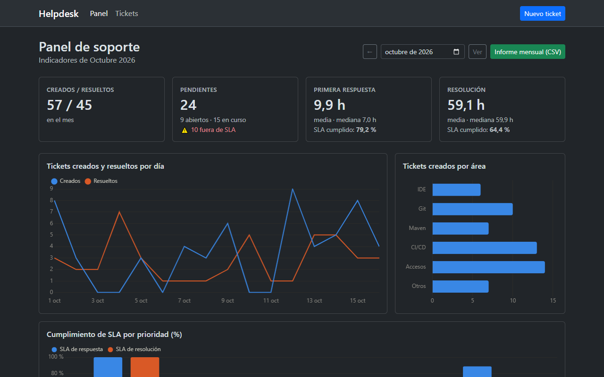

En el **móvil**, los indicadores se reorganizan en dos columnas, el menú se pliega y las gráficas ocupan todo el ancho.

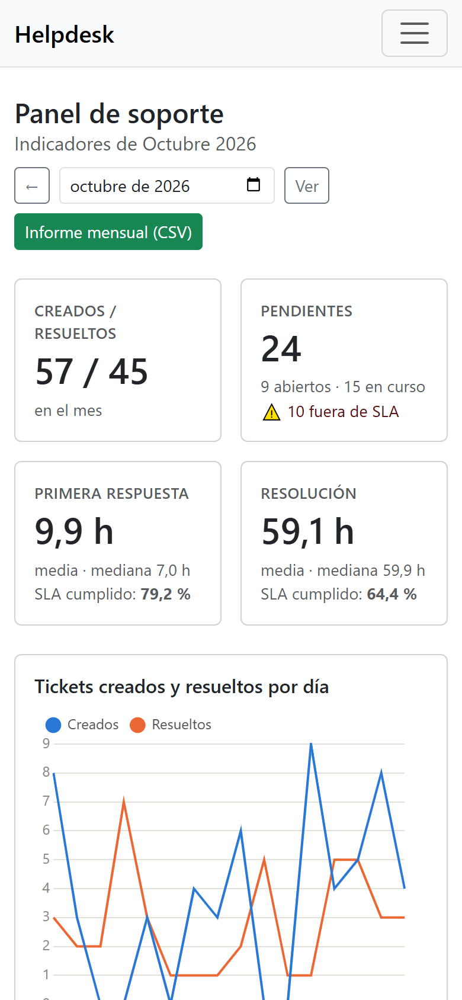
