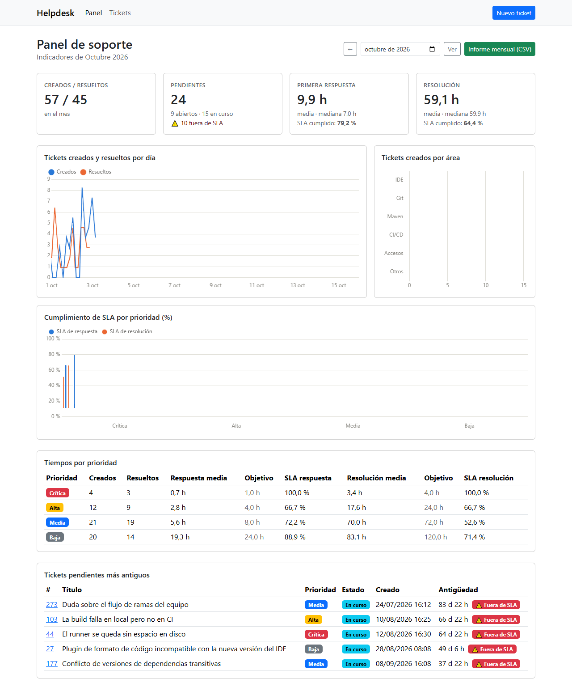

# 🎫 Helpdesk Dashboard

[](https://github.com/ecanalesn/helpdesk-dashboard/actions/workflows/ci.yml)


> Gestión de incidencias de soporte con panel de indicadores. Los tickets se dan de alta con prioridad y estado (abierto, en curso, resuelto), y el panel muestra los tiempos de respuesta y de resolución, el cumplimiento de SLA y un informe mensual exportable para dirección.



> 📖 **[Manual de uso con capturas](MANUAL.md)**: recorrido completo por el panel, el alta de tickets y su ciclo de vida.

---

## 📋 Descripción

La aplicación refleja mi trabajo de **soporte de segundo nivel**: atender incidencias, priorizarlas, cumplir los tiempos de servicio y preparar cada mes el informe de indicadores para dirección.

Las categorías de ejemplo son las herramientas que usan los equipos de desarrollo a lo largo del ciclo de vida del software: **IDE** (IntelliJ, VS Code, Eclipse), **control de versiones** (Git, GitHub, GitLab), **build y dependencias** (Maven), **integración continua** y **accesos y licencias**.

### ✨ Funcionalidades

- **Tickets**: alta con validación, listado paginado con búsqueda y filtros, y detalle con los cambios de estado:
  - *Abierto → En curso*: un técnico se lo asigna; cuenta como primera respuesta.
  - *En curso → Resuelto*.
  - *Resuelto → En curso*: reabrir.
- **SLA por prioridad**: cada prioridad tiene un objetivo de primera respuesta y otro de resolución. Cada ticket muestra si está en plazo.

  | Prioridad | Primera respuesta | Resolución |
  |---|---|---|
  | Crítica | 1 h | 4 h |
  | Alta | 4 h | 24 h |
  | Media | 8 h | 72 h |
  | Baja | 24 h | 120 h |

- **Panel mensual**:
  - Creados y resueltos, y pendientes (abiertos, en curso y fuera de SLA).
  - Tiempo medio y mediana de respuesta y de resolución.
  - Cumplimiento de SLA, en total y por prioridad.
  - Evolución diaria, tickets por área y los pendientes más antiguos.
- **Informe mensual en CSV** para dirección. Se abre con doble clic en Excel en español: punto y coma, coma decimal y BOM UTF-8 para que las tildes se vean bien.
- **API REST** para integrar con otras herramientas, con errores en formato estándar RFC 9457.
- **Datos de demostración**: 300 tickets de los últimos 90 días, generados con semilla fija (siempre los mismos).

## 🛠️ Tecnologías

| Capa | Tecnología |
|---|---|
| Lenguaje | Java 21 (LTS) |
| Framework | Spring Boot 4.1 (Spring MVC, Spring Data JPA, Bean Validation, Actuator) |
| Persistencia | JPA / Hibernate 7 sobre H2 en memoria |
| Vistas | Thymeleaf + Bootstrap 5 |
| Gráficas | Chart.js 4, con los datos de la API REST |
| Frontend | Bootstrap y Chart.js como **WebJars**: dependencias Maven, sin npm ni CDN |
| Build | Maven 3.9 + Maven Wrapper |
| Tests | JUnit Jupiter, Mockito, MockMvc, `@WebMvcTest`, `@DataJpaTest`, `@SpringBootTest` |
| Calidad | JaCoCo (cobertura ≥ 80 %, actualmente ~96 %), maven-enforcer-plugin |
| CI | GitHub Actions (Ubuntu + Windows) |

## 📦 Requisitos

- **JDK 21** o superior, con `JAVA_HOME` configurado.
- Git.
- Maven es opcional: el repositorio incluye el wrapper (`mvnw` / `mvnw.cmd`).

## 🚀 Inicio rápido

```bash
git clone https://github.com/ecanalesn/helpdesk-dashboard.git
cd helpdesk-dashboard

# Arrancar en modo desarrollo
./mvnw spring-boot:run          # Linux / macOS / Git Bash
mvnw.cmd spring-boot:run        # Windows

# O generar el JAR y ejecutarlo
./mvnw verify
java -jar target/helpdesk-dashboard-1.0.0-SNAPSHOT.jar
```

| URL | Qué hay |
|---|---|
| http://localhost:8080 | Panel de indicadores |
| http://localhost:8080/tickets | Listado de tickets |
| http://localhost:8080/api/metrics | Indicadores del mes en JSON |
| http://localhost:8080/actuator/health | Estado de la aplicación |
| http://localhost:8080/actuator/info | Versión y fecha de la build |
| http://localhost:8080/h2-console | Consola de la base de datos (JDBC URL `jdbc:h2:mem:helpdesk`, usuario `sa`, sin contraseña) |

---

## 🔨 Comandos de Maven

Maven organiza la build en un **ciclo de vida** con fases ordenadas. Al pedir una fase se ejecutan todas las anteriores:

```
validate → compile → test → package → integration-test → verify → install → deploy
```

| Comando | Qué hace | En este proyecto |
|---|---|---|
| `mvn clean` | Borra `target/`. Se combina con otros: `mvn clean verify`. | Build desde cero |
| `mvn compile` | Descarga dependencias y compila `src/main/java`. Antes, el **enforcer** comprueba Java ≥ 21, Maven ≥ 3.9 y que no haya conflictos de versiones. | `target/classes` |
| `mvn test` | Ejecuta los **tests unitarios** (`*Test.java`) con **maven-surefire-plugin**. | 48 tests |
| `mvn package` | Genera el JAR. **spring-boot-maven-plugin** lo reempaqueta como JAR ejecutable y añade `build-info` para `/actuator/info`. | `target/helpdesk-dashboard-1.0.0-SNAPSHOT.jar` |
| `mvn verify` | Además, ejecuta los **tests de integración** (`*IT.java`) con **maven-failsafe-plugin**, genera el informe de cobertura y comprueba el umbral. **Es lo que ejecuta la CI.** | +15 tests; informe en `target/site/jacoco/index.html` |
| `mvn install` | Copia el JAR y el `pom.xml` a `~/.m2/repository` para usarlos desde otros proyectos. | `io.github.ecanalesn:helpdesk-dashboard:1.0.0-SNAPSHOT` |
| `mvn dependency:tree` | Árbol de dependencias directas y transitivas, con su *scope*. | Ver abajo |
| `mvn spring-boot:run` | Arranca la aplicación desde el código, sin empaquetar. | http://localhost:8080 |

Con el wrapper los comandos son los mismos, cambiando `mvn` por `./mvnw` (o `mvnw.cmd` en Windows).

### ¿Por qué dos plugins de tests?

| | maven-surefire-plugin | maven-failsafe-plugin |
|---|---|---|
| Fase | `test` | `integration-test` + `verify` |
| Clases | `*Test.java` | `*IT.java` |
| Qué prueban | Dominio, cálculo de indicadores, CSV y controladores con `@WebMvcTest` (solo la capa web, con el servicio simulado) | Repositorio contra H2 real (`@DataJpaTest`) y aplicación completa (`@SpringBootTest`): API, vistas, WebJars, CSV y Actuator |
| Si fallan | La build se para en ese momento | La build falla en `verify`, **después** de generar el informe de cobertura, para poder revisarlo |

Así, `mvn test` da una respuesta rápida mientras se programa, y `mvn verify` da la garantía completa antes de subir los cambios.

### Opciones útiles

```bash
mvn -Dtest=MetricsCalculatorTest test        # una sola clase de tests unitarios
mvn -Dit.test=HelpdeskApplicationIT verify   # un solo test de integración
mvn verify -DskipITs                         # solo los unitarios (más rápido)
mvn verify -Djacoco.skip                     # sin cobertura
mvn dependency:tree -Dincludes=org.webjars.npm   # ¿de dónde viene esta dependencia?
mvn help:effective-pom                       # el pom final, con todo lo heredado del parent de Spring Boot
mvn spring-boot:run -Dspring-boot.run.arguments=--helpdesk.demo-data.enabled=false   # arrancar sin datos de demo
```

### Dependencias directas

```
$ mvn dependency:tree   (primer nivel)
+- org.springframework.boot:spring-boot-starter-webmvc:jar:4.1.1:compile
+- org.springframework.boot:spring-boot-starter-thymeleaf:jar:4.1.1:compile
+- org.springframework.boot:spring-boot-starter-validation:jar:4.1.1:compile
+- org.springframework.boot:spring-boot-starter-data-jpa:jar:4.1.1:compile
+- com.h2database:h2:jar:2.4.240:runtime
+- org.springframework.boot:spring-boot-h2console:jar:4.1.1:compile
+- org.springframework.boot:spring-boot-starter-actuator:jar:4.1.1:compile
+- org.webjars.npm:bootstrap:jar:5.3.8:compile
+- org.webjars.npm:chart.js:jar:4.5.1:compile
+- org.webjars:webjars-locator-lite:jar:1.1.4:compile
+- org.springframework.boot:spring-boot-devtools:jar:4.1.1:runtime (optional)
+- org.springframework.boot:spring-boot-starter-webmvc-test:jar:4.1.1:test
\- org.springframework.boot:spring-boot-starter-data-jpa-test:jar:4.1.1:test
```

- **compile**: necesarias para compilar y ejecutar.
- **runtime**: solo para ejecutar. H2 se usa a través de JDBC/JPA, sin importar sus clases.
- **optional**: DevTools no se propaga a otros proyectos ni entra en el JAR final.
- **test**: solo para los tests; no entran en el JAR.

---

## 📄 El `pom.xml`

1. **`<parent>` spring-boot-starter-parent**: aporta un BOM con cientos de versiones probadas entre sí (Spring, Hibernate, Jackson, JUnit, H2…) y la configuración base de los plugins. Por eso la mayoría de dependencias no llevan `<version>`.
2. **`<properties>`**: Java 21, las versiones que no gestiona Spring Boot (WebJars, JaCoCo), el umbral de cobertura y los flags de la JVM para los tests. Para cambiar una versión del BOM basta con redefinir su propiedad, por ejemplo `<h2.version>`.
3. **`<dependencies>`**: starters de Spring Boot, H2 (`runtime`), WebJars, DevTools (`optional`) y starters de test (`test`).
4. **`<build><plugins>`**:
   - **maven-enforcer-plugin**: Java, Maven, `dependencyConvergence` y `banDuplicatePomDependencyVersions`.
   - **maven-surefire-plugin** y **maven-failsafe-plugin**: tests unitarios y de integración. Usan `@{argLine}` para no pisar el agente de JaCoCo.
   - **jacoco-maven-plugin**: agente durante los tests, informe HTML y `check` con un mínimo del 80 % de líneas.
   - **spring-boot-maven-plugin**: JAR ejecutable y `build-info`.

### ¿Por qué no maven-shade-plugin?

En mi otro proyecto, [automation-reports-java](https://github.com/ecanalesn/automation-reports-java), el JAR ejecutable se genera con **maven-shade-plugin**, que mete todas las clases de las dependencias en un único JAR plano.

En Spring Boot se usa **spring-boot-maven-plugin**, porque Spring Boot depende de ficheros que muchas librerías repiten con el mismo nombre: `META-INF/spring/*.imports`, `META-INF/spring.factories`, `META-INF/services/*`… Al aplanarlos con shade hay que fusionarlos uno a uno con *transformers*, y si se olvida alguno la aplicación arranca sin parte de su autoconfiguración.

El plugin de Spring Boot no aplana nada: guarda cada dependencia como un JAR dentro de `BOOT-INF/lib/` y usa su propio *launcher* para cargarlas. Es la opción que recomienda Spring y evita esa clase de errores.

---

## ⚙️ Integración continua

El workflow [`.github/workflows/ci.yml`](.github/workflows/ci.yml) se ejecuta en **cada push y en cada pull request**, en **Ubuntu y Windows**:

1. Instala JDK 21 Temurin con caché de `~/.m2`.
2. Ejecuta `./mvnw verify`: tests unitarios, tests de integración y umbral de cobertura.
3. Si algo falla, sube los informes de surefire y failsafe como artefacto.
4. Guarda como artefactos el informe de cobertura de JaCoCo y el JAR ejecutable.

## 💻 Abrir el proyecto en el IDE

El proyecto no depende de ningún IDE: la fuente de verdad es el `pom.xml`. Los ficheros compartidos de cada editor están versionados.

### IntelliJ IDEA (Community o Ultimate)

1. **File → Open** → carpeta del proyecto → *Open as Project*. IntelliJ importa Maven automáticamente.
2. Si falta el JDK: **File → Project Structure → SDK → Download JDK → Temurin 21**.
3. En el desplegable de ejecución aparecen las configuraciones compartidas de [`.run/`](.run): **Helpdesk** (arranca la aplicación) y **mvn verify**. Son de tipo *Application*, así que funcionan también en la edición Community.
4. Tests: clic derecho en `src/test/java` → *Run 'All Tests'*. Con cobertura: *More Run/Debug → Run with Coverage*.
5. Con DevTools, al recompilar (**Build → Build Project**, Ctrl+F9) la aplicación se reinicia sola.

### Visual Studio Code

1. **File → Open Folder** → carpeta del proyecto.
2. Instalar las extensiones recomendadas ([`.vscode/extensions.json`](.vscode/extensions.json)): *Extension Pack for Java* y *Spring Boot Extension Pack*.
3. **Run and Debug** → **Helpdesk (http://localhost:8080)** ([`.vscode/launch.json`](.vscode/launch.json)). El *Spring Boot Dashboard* también detecta la aplicación.
4. Tests: vista **Testing**. Ciclo de vida: vista **Maven** → clic derecho → `clean`, `test`, `verify`…

[`.editorconfig`](.editorconfig) unifica codificación, finales de línea e indentación en los dos editores. [`.gitattributes`](.gitattributes) mantiene `mvnw` con finales LF aunque se haga commit desde Windows.

---

## 🔌 API REST

| Método | Ruta | Descripción |
|---|---|---|
| `GET` | `/api/tickets?status=&priority=&q=&page=&size=` | Listado paginado con filtros |
| `GET` | `/api/tickets/{id}` | Un ticket |
| `POST` | `/api/tickets` | Alta → `201 Created` + cabecera `Location` |
| `POST` | `/api/tickets/{id}/start` | Pasar a *en curso*. Cuerpo: `{"assignee": "…"}` |
| `POST` | `/api/tickets/{id}/resolve` | Resolver |
| `POST` | `/api/tickets/{id}/reopen` | Reabrir |
| `GET` | `/api/metrics?month=AAAA-MM` | Indicadores del mes (por defecto, el actual) |
| `GET` | `/reports/monthly.csv?month=AAAA-MM` | Informe mensual en CSV |

```bash
curl -i -X POST http://localhost:8080/api/tickets \
     -H "Content-Type: application/json" \
     -d '{"title":"La pipeline falla en el paso de tests","requester":"Hugo","category":"INTEGRACION_CONTINUA","priority":"ALTA"}'

curl -X POST http://localhost:8080/api/tickets/301/start \
     -H "Content-Type: application/json" -d '{"assignee":"Estefanía"}'
```

Errores en formato `application/problem+json` (RFC 9457):

| Código | Cuándo |
|---|---|
| `400` | Datos no válidos (validación, enum desconocido, JSON mal formado) |
| `404` | El ticket no existe |
| `409` | Cambio de estado no permitido (por ejemplo, resolver un ticket ya resuelto) |

```json
{ "title": "Cambio de estado no permitido", "status": 409,
  "detail": "El ticket #301 ya está resuelto" }
```

## 📐 Cómo se calculan los indicadores

- **Tiempo de primera respuesta**: de la creación hasta que un técnico se asigna el ticket. Se calcula para los tickets respondidos dentro del mes.
- **Tiempo de resolución**: de la creación a la resolución. Se calcula para los tickets resueltos dentro del mes, aunque se crearan antes.
- **Cumplimiento de SLA**: porcentaje de esos tickets que estuvo dentro del objetivo de su prioridad.
- **Pendientes**: los tickets sin resolver al cierre del mes, o en este momento si es el mes en curso.
- Se muestran la **media** y la **mediana**, porque unos pocos tickets atascados disparan la media y la mediana refleja mejor el caso típico.
- Las horas son **naturales** (24×7). Los días y meses se agrupan con la zona horaria configurada (`helpdesk.time-zone`, por defecto Europe/Madrid), incluido el cambio de hora.

El cálculo está en una clase pura, [`MetricsCalculator`](src/main/java/io/github/ecanalesn/helpdesk/metrics/MetricsCalculator.java), sin base de datos ni reloj del sistema, y se prueba con un escenario fijo en [`MetricsCalculatorTest`](src/test/java/io/github/ecanalesn/helpdesk/metrics/MetricsCalculatorTest.java). Toda la aplicación pide la hora a un `Clock` inyectado, así que los tests usan un reloj fijo y dan siempre el mismo resultado.

## 📁 Estructura del proyecto

```
helpdesk-dashboard/
├── .github/workflows/ci.yml
├── .mvn/wrapper/                      # Versión de Maven fijada para el wrapper
├── .run/                              # Run configurations de IntelliJ
├── .vscode/                           # Extensiones, ajustes y launch de VS Code
├── docs/screenshots/                  # Capturas del README y del manual
├── MANUAL.md                          # Manual de uso con capturas
├── src/main/java/io/github/ecanalesn/helpdesk/
│   ├── HelpdeskApplication.java
│   ├── ticket/                        # Dominio: Ticket (JPA), Priority (SLA), Status, Category, repositorio y servicio
│   ├── metrics/                       # Cálculo de indicadores e informe CSV
│   ├── api/                           # API REST + gestión de errores (ProblemDetail)
│   ├── web/                           # Controladores Thymeleaf y formato para las vistas
│   └── config/                        # Propiedades, reloj y datos de demostración
├── src/main/resources/
│   ├── application.properties
│   ├── templates/                     # Vistas Thymeleaf
│   └── static/                        # CSS y JS de las gráficas
├── src/test/java/...                  # *Test (surefire) y *IT (failsafe)
├── mvnw  mvnw.cmd
└── pom.xml
```

## 🔧 Configuración

En [`application.properties`](src/main/resources/application.properties):

| Propiedad | Por defecto | Descripción |
|---|---|---|
| `helpdesk.time-zone` | `Europe/Madrid` | Zona horaria del panel |
| `helpdesk.demo-data.enabled` | `true` | Carga los tickets de demostración al arrancar |
| `helpdesk.demo-data.tickets` | `300` | Número de tickets de demostración |
| `helpdesk.demo-data.days` | `90` | Días hacia atrás que cubren |
| `helpdesk.demo-data.seed` | `42` | Semilla (mismos datos en cada arranque) |
| `server.port` | `8080` | Puerto HTTP |

Cualquier propiedad se puede cambiar al arrancar sin tocar el código: `java -jar app.jar --server.port=9090 --helpdesk.demo-data.enabled=false`.

## 🩺 Solución de problemas

| Síntoma | Causa y solución |
|---|---|
| `Port 8080 was already in use` | Otro proceso usa el puerto. Arranca con `--server.port=8081` o localiza el proceso con `netstat -ano \| findstr :8080`. |
| `RequireJavaVersion failed` | Maven se ejecuta con un JDK antiguo. Revisa `mvn -v` y `JAVA_HOME`. |
| Los tests de integración fallan solo en CI | Revisa el artefacto `test-reports-<os>` del workflow: incluye los informes de surefire y failsafe. |
| `Coverage checks have not been met` | La cobertura ha bajado del 80 %. Abre `target/site/jacoco/index.html` para ver qué falta por probar. |
| La página no tiene estilos | Los WebJars no se han descargado o el IDE no ha recargado el `pom.xml`. Ejecuta `mvn compile` y recarga el proyecto Maven. |
| Los cambios en las plantillas no se ven | Con DevTools basta con recompilar. Sin DevTools, reinicia la aplicación. |
| La base de datos está vacía tras reiniciar | Es lo esperado: H2 está en memoria. Para persistir, usa una URL de fichero (`jdbc:h2:file:./data/helpdesk`) o una base de datos externa. |

## 🗺️ Posibles mejoras

- Base de datos persistente (PostgreSQL) con migraciones de Flyway.
- Autenticación con Spring Security (perfiles de técnico y de solicitante).
- Historial de cambios de estado y comentarios en cada ticket.
- SLA en horario laboral (excluyendo noches, fines de semana y festivos).

---

## 📝 Nota

Los tickets, nombres y tiempos son datos ficticios generados para la demostración.

**Desarrollado por**: Estefanía Canales
**Fecha**: 16/10/2026
